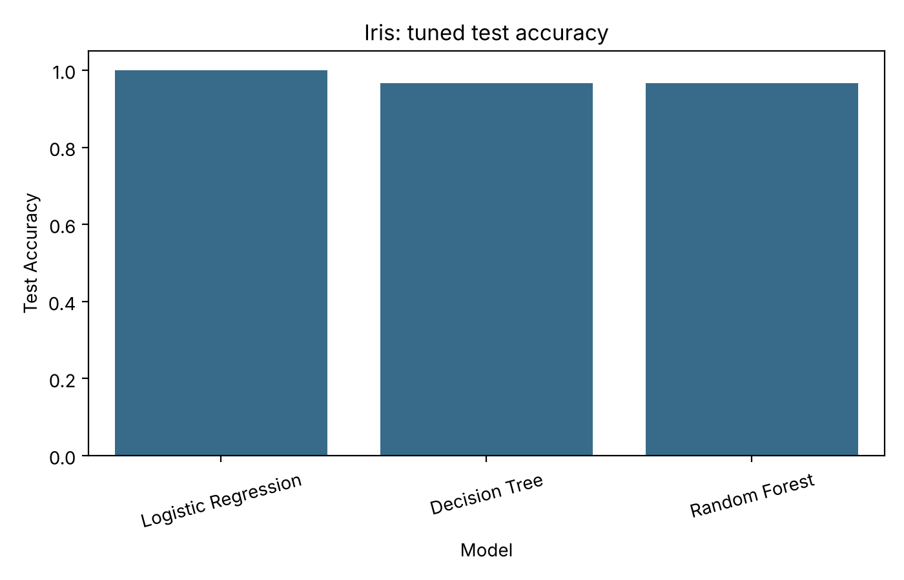
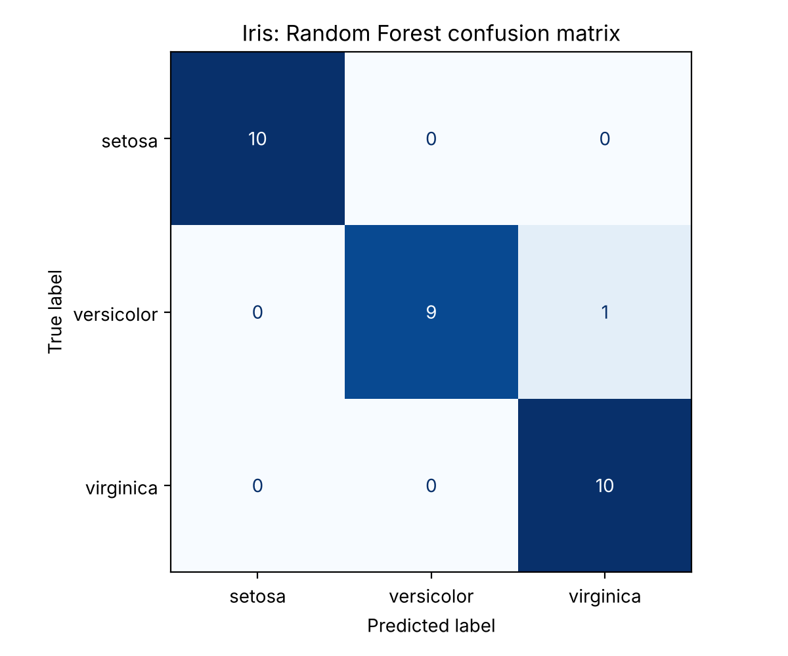
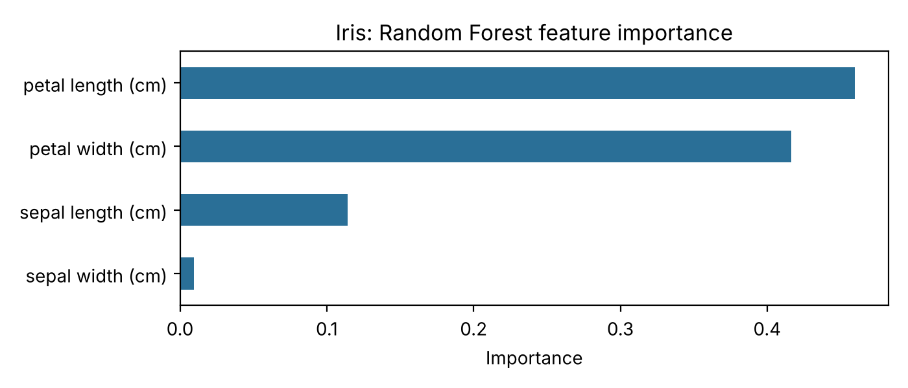

# ML Classification Benchmark

[](https://github.com/Zain62543/ml-classification-benchmark/actions/workflows/ci.yml)


A small, tested, reproducible toolkit that benchmarks **Random Forest**, **Logistic Regression** and **Decision Tree** classifiers on any tabular dataset: stratified split, cross-validation, grid-search tuning, held-out metrics and publication-ready figures, in one command.

It ships with the Iris dataset as a demo and also accepts **your own CSV file**.

## Quick start

```bash
git clone https://github.com/Zain62543/ml-classification-benchmark.git
cd ml-classification-benchmark
python -m venv .venv && source .venv/bin/activate      # Windows: .venv\Scripts\activate
pip install -e ".[dev]"

ml-classify                                  # Iris demo -> reports/
ml-classify --csv mydata.csv --target label  # your own data
pytest                                       # run the test suite
```

Options: `--out`, `--seed`, `--test-size`, `--folds`. Non-numeric feature columns are one-hot encoded and missing values are median-imputed inside the pipeline, so there is no leakage from the test set.

## Example output (Iris, seed 42)

5-fold CV on the training split, then tuned models scored on a 30-sample held-out test set:

| Model | Test accuracy | Macro F1 |
|---|---|---|
| Logistic Regression | 1.000 | 1.000 |
| Decision Tree | 0.967 | 0.967 |
| Random Forest | 0.967 | 0.967 |



| Confusion matrix | Feature importance |
|---|---|
|  |  |

> **Reading these numbers honestly:** Iris is small and nearly linearly separable. With 30 test samples, a difference of 0.033 is a *single* prediction, so these results do not show that one model is better than another. Iris is used here only as a fast, public demo of the workflow. On real client data the same pipeline is meant to be run with proper cross-validation, and I report CV mean ± standard deviation (`reports/cv_baseline.csv`) alongside the test score.

Full numbers are in [`reports/`](reports/): `cv_baseline.csv`, `test_results.csv`, `summary.json` (including the best hyperparameters).

## Repository layout

```text
.
├── src/ml_classification/   # installable package
│   ├── data.py              # Iris / CSV loading, stratified split
│   ├── models.py            # pipelines + hyperparameter grids
│   ├── evaluate.py          # cross-validation, GridSearchCV, held-out metrics
│   ├── plots.py             # confusion matrix, feature importance, comparison
│   └── cli.py               # `ml-classify` command
├── tests/                   # pytest suite (8 tests, run in CI)
├── notebooks/               # step-by-step walkthrough of the same workflow
│   └── 01_iris_model_comparison.ipynb
├── reports/                 # generated metrics (CSV/JSON) and figures
├── .github/workflows/ci.yml # lint + tests on Python 3.10 and 3.12
├── pyproject.toml
└── LICENSE
```

## Evaluation checklist for real datasets

Report more than accuracy: precision/recall/F1, the confusion matrix, cross-validation (not just one split), class balance and preprocessing decisions, a simple baseline, and known limitations.

## Engineering notes

- **No leakage:** imputation and scaling live inside `Pipeline`, so they are fit on training folds only.
- **Reproducible:** every random component takes the same `--seed`.
- **Tested:** data loading, splitting, CV ordering, tuning, CSV edge cases (missing target, unknown column) and an end-to-end CLI run.
- **Static outputs:** figures are saved as PNG, so the run works headless on servers and CI.

## Skills demonstrated

Python packaging · scikit-learn pipelines · cross-validation and hyperparameter tuning · model evaluation (precision/recall/F1, confusion matrix) · pytest · GitHub Actions CI · reproducible reporting

## Author

**Zain Ud Din**, MPhil Physics (Condensed Matter Physics) | Data Science, Machine Learning & Scientific Computing

- GitHub: [Zain62543](https://github.com/Zain62543)
- LinkedIn: [Zain Ud Din](https://www.linkedin.com/in/zain-ud-din-9152a2299/)
- Email: [marwatzain543@gmail.com](mailto:marwatzain543@gmail.com)

Released under the [MIT License](LICENSE).
